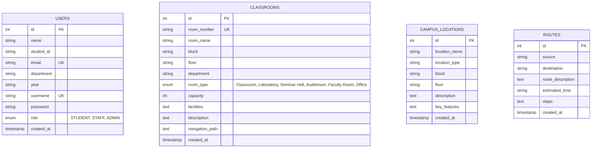

# Find My Classroom – Campus Navigator

An interactive college web application for locating classrooms, laboratories, seminar halls, departments, and key landmarks with step-by-step campus navigation pathways.

---

## Table of Contents
1. [Project Overview](#1-project-overview)
2. [Key Features](#2-key-features)
3. [Technology Stack](#3-technology-stack)
4. [Prerequisites & Software Requirements](#4-prerequisites--software-requirements)
5. [Database Setup (MySQL)](#5-database-setup-mysql)
6. [Configuring Database Credentials](#6-configuring-database-credentials)
7. [Building the Project (Maven)](#7-building-the-project-maven)
8. [Deploying & Running on Apache Tomcat 10.x](#8-deploying--running-on-apache-tomcat-10x)
9. [Pre-Configured Demo Credentials](#9-pre-configured-demo-credentials)
10. [Application Architecture & Directory Structure](#10-application-architecture--directory-structure)
11. [Database Schema Design](#11-database-schema-design)
12. [Testing & Verification Guide](#12-testing--verification-guide)
13. [Viva / Faculty Presentation Guide](#13-viva--faculty-presentation-guide)
14. [Troubleshooting & FAQs](#14-troubleshooting--faqs)

---

## 1. Project Overview
Navigating a large multi-block college campus can be difficult for newly admitted students, junior faculty, and visitors. **Find My Classroom – Campus Navigator** solves this problem by providing a digital wayfinding platform where users can:
- Instantly search classrooms and laboratories by room code (e.g. `A204`, `LAB-A1`), floor, block, or department.
- Inspect room specifications, seating capacity, and smart amenities (Projector, Smart Board, AC, Wi-Fi).
- Follow step-by-step walking directions from the campus main gate to the classroom door.
- Explore campus blocks interactively via an HTML/CSS schematic grid.
- Manage classroom inventory and campus landmark points with an administrative control panel.

---

## 2. Key Features

### 🎓 Student / User Portal
- **Session-Based Authentication:** Clean login with quick demo login autofill.
- **Self-Registration:** Student signup with departmental and academic year assignment.
- **Multi-Filter Classroom Search:** Search by room number, block, floor, department, and room type (`Classroom`, `Laboratory`, `Seminar Hall`, `Auditorium`, `Faculty Room`, `Office`).
- **Classroom Details & Waypoint Guide:** Displays room capacity, amenities, and step-by-step navigation path.
- **Interactive Campus Map Schematic:** Visual grid of campus buildings with clickable block information drawers.
- **Point-to-Point Directions:** Computes route instructions between any campus starting point and destination.
- **My Profile:** View and update personal academic profile details.

### 🛡️ Administrative Portal
- **Admin Dashboard:** Real-time metrics on total rooms, laboratories, auditoriums, campus blocks, and registered users.
- **Classroom Inventory Management:** Add, edit, delete, and browse classrooms and labs.
- **Campus Landmark Management:** Manage campus buildings, amenities, and recreational zones.
- **Role-Based Access Control:** Secure `AuthFilter` restricts administrative routes to verified `ADMIN` accounts.

---

## 3. Technology Stack

| Layer | Technology | Details |
|---|---|---|
| **Frontend** | HTML5, CSS3, Vanilla JS, JSP | Responsive custom college theme, Bootstrap 5.3, FontAwesome 6 |
| **Backend** | Java 17 | Jakarta EE Servlet API 5.0+ (compatible with Tomcat 10.x) |
| **Data Access** | JDBC (PreparedStatements) | `com.mysql.cj.jdbc.Driver` |
| **Database** | MySQL 8.x | Relational schema `campus_navigator` |
| **Server** | Apache Tomcat 10.1+ | Servlet Container |
| **Build Tool** | Apache Maven | Generates `target/campus-navigator.war` |

---

## 4. Prerequisites & Software Requirements

1. **Java Development Kit (JDK):** Version 17 or higher
2. **MySQL Server:** Version 8.0 or higher (or XAMPP / WAMP)
3. **Apache Tomcat:** Version 10.0 or 10.1+
4. **Apache Maven:** Version 3.8+ (or use the included `./mvnw.cmd` wrapper)

---

## 5. Database Setup (MySQL)

1. Open your terminal or MySQL Workbench / Command Line Client:
   ```bash
   mysql -u root -p
   ```
2. Run the database script [`database.sql`](file:///C:/Users/Ilakiya%20R/.gemini/antigravity/scratch/campus-navigator/database.sql):
   ```sql
   source C:/Users/Ilakiya R/.gemini/antigravity/scratch/campus-navigator/database.sql;
   ```
   *(Or copy-paste the contents of `database.sql` directly into MySQL Workbench / phpMyAdmin and execute).*

3. Verify tables were created:
   ```sql
   USE campus_navigator;
   SHOW TABLES;
   ```
   You will see 4 tables: `users`, `classrooms`, `campus_locations`, and `routes`.

---

## 6. Configuring Database Credentials

The database connection parameters are defined in:
[`src/main/java/com/campusnavigator/util/DBConnection.java`](file:///C:/Users/Ilakiya%20R/.gemini/antigravity/scratch/campus-navigator/src/main/java/com/campusnavigator/util/DBConnection.java)

By default, the utility connects to:
- **Host:** `localhost:3306`
- **Database:** `campus_navigator`
- **Username:** `root`
- **Password:** `root` *(with automatic fallback to blank `""` for standard XAMPP configurations)*

To change credentials, either edit `DBConnection.java` or provide environment variables / JVM properties:
```properties
DB_HOST=localhost
DB_PORT=3306
DB_NAME=campus_navigator
DB_USER=root
DB_PASS=your_mysql_password
```

---

## 7. Building the Project (Maven)

Open PowerShell or Command Prompt in the project root directory:

```powershell
cd "C:\Users\Ilakiya R\.gemini\antigravity\scratch\campus-navigator"
$env:JAVA_HOME = "C:\Program Files\Java\jdk-17"
.\mvnw.cmd clean package
```

This compiles all Java source files and produces the deployable WAR artifact:
`target/campus-navigator.war`

---

## 8. Deploying & Running on Apache Tomcat 10.x

### Manual Deployment:
1. Copy `target/campus-navigator.war` into your Tomcat `webapps/` folder:
   ```powershell
   copy target\campus-navigator.war "C:\apache-tomcat-10.1.x\webapps\"
   ```
2. Start Tomcat:
   ```powershell
   "C:\apache-tomcat-10.1.x\bin\startup.bat"
   ```
3. Open your browser and navigate to:
   ```
   http://localhost:8080/campus-navigator/
   ```

---

## 9. Pre-Configured Demo Credentials

For quick evaluation, click the demo shortcut pills on [`login.jsp`](file:///C:/Users/Ilakiya%20R/.gemini/antigravity/scratch/campus-navigator/src/main/webapp/login.jsp) or enter manually:

| Role | Username | Password | Department / Description |
|---|---|---|---|
| **ADMIN** | `admin` | `admin123` | Campus Administration & Facilities Management |
| **STAFF** | `staff` | `staff123` | Computer Science Faculty |
| **STUDENT** | `student` | `student123` | 3rd Year CS Student (John Doe) |

---

## 10. Application Architecture & Directory Structure

```
campus-navigator/
 ├── pom.xml                                     <- Maven configuration & dependencies
 ├── database.sql                                <- Complete MySQL schema + seed dataset
 ├── README.md                                   <- Comprehensive documentation
 ├── mvnw.cmd / mvnw                             <- Standalone Maven Wrapper
 └── src/
     └── main/
         ├── java/com/campusnavigator/
         │   ├── controller/                     <- Jakarta Servlets (Request Handlers)
         │   │   ├── LoginServlet.java
         │   │   ├── RegisterServlet.java
         │   │   ├── LogoutServlet.java
         │   │   ├── DashboardServlet.java
         │   │   ├── ClassroomSearchServlet.java
         │   │   ├── ClassroomDetailsServlet.java
         │   │   ├── CampusLocationServlet.java
         │   │   ├── RouteServlet.java
         │   │   ├── ProfileServlet.java
         │   │   ├── AdminDashboardServlet.java
         │   │   ├── AdminClassroomServlet.java
         │   │   └── AdminLocationServlet.java
         │   │
         │   ├── dao/                            <- Data Access Objects (JDBC PreparedStatements)
         │   │   ├── UserDAO.java
         │   │   ├── ClassroomDAO.java
         │   │   ├── CampusLocationDAO.java
         │   │   └── RouteDAO.java
         │   │
         │   ├── model/                          <- Java Bean Models
         │   │   ├── User.java
         │   │   ├── Classroom.java
         │   │   ├── CampusLocation.java
         │   │   └── Route.java
         │   │
         │   ├── filter/                         <- Role-Based Access Filter
         │   │   └── AuthFilter.java
         │   │
         │   └── util/                           <- Database Connection Utility
         │       └── DBConnection.java
         │
         └── webapp/
             ├── index.jsp                       <- Landing page
             ├── login.jsp                       <- Login page with demo autofill
             ├── register.jsp                    <- Student self-registration
             ├── dashboard.jsp                   <- User navigation dashboard
             ├── find-classroom.jsp              <- Multi-filter classroom search
             ├── classroom-details.jsp           <- Room specs & waypoint path
             ├── campus-map.jsp                  <- Interactive map & route finder
             ├── profile.jsp                     <- User profile viewer & editor
             ├── access-denied.jsp               <- 403 Forbidden page
             ├── error.jsp                       <- 404/500 Error handler
             ├── css/
             │   └── style.css                   <- Polished modern custom CSS
             ├── js/
             │   └── script.js                   <- Form validation & map interactivity
             ├── includes/                       <- Modular JSP fragments
             │   ├── header.jsp
             │   ├── footer.jsp
             │   └── alerts.jsp
             ├── admin/                          <- Admin views
             │   ├── dashboard.jsp
             │   ├── manage-classrooms.jsp
             │   ├── classroom-form.jsp
             │   └── manage-locations.jsp
             └── WEB-INF/
                 └── web.xml                     <- Deployment descriptor
```

---

## 11. Database Schema Design



---

## 12. Testing & Verification Guide

1. **Student Registration & Login Flow:**
   - Navigate to `/register.jsp` and create a student account.
   - Log in using your new username and password.
   - Verify that you are redirected to the `/dashboard`.

2. **Classroom Search Flow:**
   - Click **Find Classroom** from the navigation bar.
   - Search for room `A204` or filter by Block: `A Block`, Floor: `2nd Floor`, Room Type: `Classroom`.
   - Click **View Path** on Room `A204`.
   - Verify that room specifications, amenities badges, and step-by-step waypoint directions are rendered.

3. **Campus Map & Route Direction Flow:**
   - Click **Campus Locations** from the navigation bar.
   - Click on any block card (e.g. `A Block` or `Central Library`) to view departments and key facilities in a modal.
   - Enter Source: `Main Gate` and Destination: `B305`, then click **Show Route**.
   - Verify the computed walking directions and estimated time.

4. **Admin Management Flow:**
   - Log out and log in as `admin` / `admin123`.
   - Navigate to the **Admin Panel** $\rightarrow$ **Manage Classrooms**.
   - Click **Add New Classroom**, fill in details for a new room (e.g. `D101`), and submit.
   - Verify the room appears in the classroom list and can be searched by students.

---

## 13. Viva / Faculty Presentation Guide

### Key Questions & Answers for Viva:

- **Q: What architecture pattern is used in this project?**
  - **A:** The project follows the standard **MVC (Model-View-Controller)** pattern. Servlets act as Controllers handling HTTP requests, Java Beans (`Classroom`, `User`) serve as Models, DAOs manage JDBC persistence, and JSPs render the View layer.
- **Q: How does the application prevent SQL Injection?**
  - **A:** All database queries in the DAO classes utilize `java.sql.PreparedStatement` with parameterized placeholders (`?`) instead of string concatenation.
- **Q: How is authentication and session management implemented?**
  - **A:** Upon successful login in `LoginServlet`, an `HttpSession` is created and the `User` object is stored. The `AuthFilter` intercepts protected URLs (`/dashboard`, `/admin/*`) and redirects unauthenticated requests to `login.jsp`.
- **Q: Why is Jakarta Servlet API used instead of `javax.servlet`?**
  - **A:** Tomcat 10+ uses the Jakarta EE specification (`jakarta.servlet.*`). Using `jakarta.*` packages ensures native compatibility with modern Tomcat versions.

---

## 14. Troubleshooting & FAQs

- **HTTP 404 Error:** Ensure Tomcat is running and `campus-navigator.war` is placed inside `webapps/`.
- **Database Connection Error:** Ensure MySQL is running on port 3306 and that `database.sql` has been executed. Check username/password in `DBConnection.java`.
- **Access Denied on Admin Routes:** Ensure you are logged in with the `admin` account.
